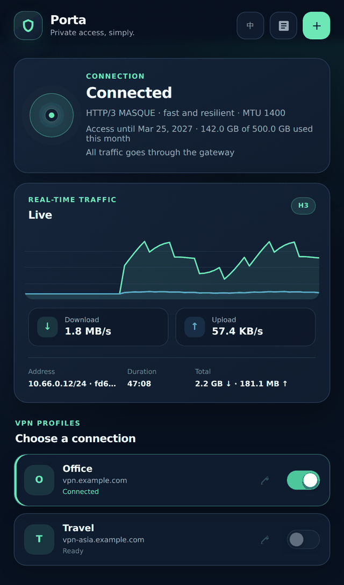
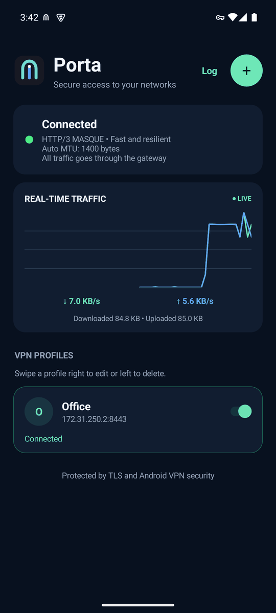
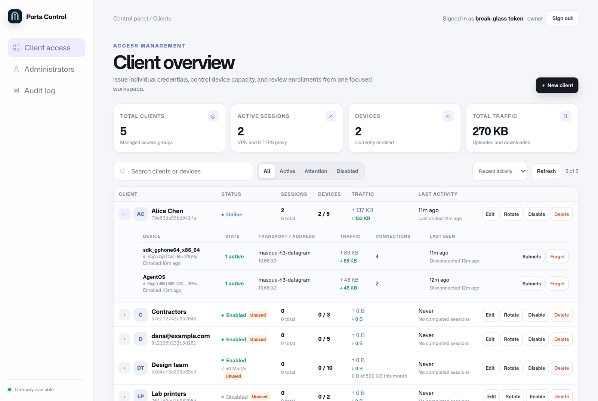

# Porta

Porta is a dual-stack VPN and authenticated HTTPS forward proxy built on MASQUE
`CONNECT-IP`. One gateway serves HTTP/2 over TCP and HTTP/3 over QUIC/UDP on
the same port, with clients for Linux, Windows, and Android, and the
[PortaKit](apple/README.md) foundation for macOS and iOS apps.

<p>


</p>



New to Porta? The [user manual](docs/user-manual.md) shows how to install
and connect each client, and the [administrator guide](docs/admin-guide.md)
walks through the admin console.

## Features

- **Tunnels:** a full or split VPN over MASQUE `CONNECT-IP`, HTTP/3 first with
  automatic fallback to HTTP/2 on the same port, automatic MTU selection,
  IPv4 and IPv6, and an authenticated HTTPS forward proxy.
- **Clients:** desktop apps for Windows and Linux with a tray and live
  traffic, command-line clients for Linux and Windows, and an Android app
  with QR setup and per-app tunnelling, in English and Simplified Chinese.
- **Leak protection:** clients block traffic outside the tunnel while
  connecting, reconnecting and after errors, and let users sign in to hotel
  and airport Wi-Fi briefly.
- **Accounts and devices:** one token per person or team, per-device keys,
  device limits, approval of new devices, hardware-protected keys
  (Android key attestation and TPM), expiry dates, monthly quotas and speed
  limits.
- **Onboarding:** private access links and QR codes, a downloads portal, and
  sign-in with your organisation through OpenID Connect.
- **Administration:** a web console with owner, operator and viewer roles,
  two-factor authentication, single sign-on and an audit log.
- **Networks:** access policies, a built-in DNS resolver, subnet routing,
  client-to-client traffic with direct peer-to-peer paths, multi-hop relays,
  named exits, transport relays and several gateways per account.
- **Operations:** one-command deployment with Let's Encrypt, in-place
  restarts and upgrades that clients reconnect from within about a second,
  backups, Prometheus metrics and alerts, and signed releases.

## Deploy

Porta can be deployed from either:

- the small release bundle, recommended for production; or
- a full Git checkout.

In both cases, `scripts/deploy.sh` downloads and verifies the selected release
artifacts by default. Add `--build-local` only when deploying binaries built
from a full source checkout.

Do not copy `deploy.sh` by itself. It also requires the helper scripts in
`scripts/` and service assets in `deploy/`.

### 1. Get the deployment files

**Release bundle:**

```bash
set -o pipefail
gh release download --repo huangyingting/porta \
  --pattern porta-deploy.tar.gz --pattern SHA256SUMS \
  --pattern SHA256SUMS.sig --pattern release-signing-cert.der &&
expected=763e9e1dd32d2f6538149d7b86809af698d1f96c9e29b4e30ec35fc1a8969bd8 &&
actual=$(openssl x509 -inform DER -in release-signing-cert.der \
  -noout -fingerprint -sha256 | tr -d ':' | cut -d= -f2 | tr '[:upper:]' '[:lower:]') &&
test "$actual" = "$expected" &&
openssl x509 -inform DER -in release-signing-cert.der -pubkey -noout \
  > release-public-key.pem &&
openssl dgst -sha256 -verify release-public-key.pem \
  -signature SHA256SUMS.sig SHA256SUMS &&
grep ' porta-deploy.tar.gz$' SHA256SUMS | sha256sum -c - &&
tar -xzf porta-deploy.tar.gz &&
cd porta &&
GH_TOKEN=$(gh auth token) &&
export GH_TOKEN
```

The repository is private, so `gh` must be authenticated with read access.

**Full Git checkout:**

```sh
git clone https://github.com/huangyingting/porta.git
cd porta
export GH_TOKEN=$(gh auth token)
```

### 2. Install the gateway

For a standalone server on TCP and UDP 443 with automatic Let's Encrypt:

```sh
sudo --preserve-env=GH_TOKEN ./scripts/deploy.sh \
  --domain vpn.example.com \
  --acme-email admin@example.com
```

If another service manages the certificate or already owns ports 80 and 443,
run Porta directly on another public port:

```sh
sudo --preserve-env=GH_TOKEN ./scripts/deploy.sh \
  --domain vpn.example.com \
  --cert /absolute/path/fullchain.pem \
  --key /absolute/path/privkey.pem \
  --port 8443
```

Allow both TCP and UDP on the selected tunnel port. Automatic Let's Encrypt
also requires public TCP port 80. The installer configures systemd, TUN,
forwarding, NAT, a Porta-scoped nftables input guard, certificate renewal or
synchronization, client downloads, and the loopback operations listener.

The HTTPS forward proxy is enabled by default. Add
`--disable-forward-proxy` only for a VPN-only deployment.

VPN clients cannot reach the gateway VM's cloud metadata service or its host
services other than ping and DNS; add `--client-host-access` to allow host
services. See [client isolation](docs/deployment.md#client-isolation).

### Cascade relays (multi-hop)

Gateways chain like multi-hop WireGuard: clients connect to the first gateway
and their traffic exits from the last one.

```text
clients -> relay.example.com -> exit.example.com -> Internet
```

Deploy `exit.example.com` as above, create a client token for the relay in its
admin portal, then deploy the relay:

```bash
read -rsp "Exit client token: " PORTA_UPSTREAM_TOKEN && echo
export PORTA_UPSTREAM_TOKEN
sudo --preserve-env=GH_TOKEN,PORTA_UPSTREAM_TOKEN ./scripts/deploy.sh \
  --domain relay.example.com \
  --upstream https://exit.example.com
unset PORTA_UPSTREAM_TOKEN
```

Repeat with `--upstream https://relay.example.com` for a longer chain. Every
hop can keep the default pool, clients need no changes, and relays fail
closed: if the next hop is down, relayed traffic is dropped instead of leaving
through the relay's own connection. Add `--client-to-client` to let clients of
one gateway reach each other (hub and spoke), and `--peer-to-peer` to let
devices connect directly through NATs where they can (mesh). See
[cascade relays](docs/deployment.md#cascade-relays-multi-hop).
Forward-proxy CONNECT uses HTTP/1.1 or HTTP/2; HTTP/3 is reserved for the
native MASQUE CONNECT-IP tunnel.

## Use

### Browser portal

Open the deployed URL, such as `https://vpn.example.com:8443`.

- Enter `PORTA_ADMIN_TOKEN` to manage client accounts, tokens, devices, and
  usage.
- Enter an active client token to download the matching Linux, Windows, or
  Android client.
- With [user single sign-on](docs/deployment.md#letting-users-sign-in-with-single-sign-on),
  people choose **Sign in with your organisation** and get an account of
  their own instead of a token.

Retrieve the initial tokens on the server:

```sh
sudo sed -n 's/^PORTA_ADMIN_TOKEN=//p' /etc/porta/porta.env
sudo sed -n 's/^PORTA_TOKEN=//p' /etc/porta/porta.env
```

### Linux client

```bash
chmod +x porta-client-linux-amd64
read -rsp "Client token: " PORTA_TOKEN && echo
export PORTA_TOKEN
sudo --preserve-env=PORTA_TOKEN ./porta-client-linux-amd64 \
  --server https://vpn.example.com:8443
unset PORTA_TOKEN
```

For unattended use, store the token in an owner-only file and pass
`--token-file /etc/porta/client.token` instead of `PORTA_TOKEN`; see the
[client guide](docs/clients.md#linux-cli) for a systemd unit.

For a window and tray instead of a terminal, install the
[Linux desktop app](docs/clients.md#linux-desktop-app).

Linux configures routes, DNS, and an owned fail-closed firewall automatically;
root, iproute2, nftables, and systemd-resolved's local stub are required.
Desktop clients default to HTTP/3 with safe HTTP/2 fallback. See the
[client guide](docs/clients.md) for protection boundaries, manual networking,
and `--cleanup-network` recovery after a crash.
Native clients generate a persistent P-256 signing key locally. Its public-key
fingerprint is the immutable device ID; the Android device/model name or
Windows/Linux machine name is separate readable metadata. Renaming a device
updates its displayed name without consuming another enrollment. The private
key is never sent to Porta.

### Windows client

Extract `porta-client-windows-amd64.zip` and launch `porta.exe` as
administrator. Add a profile with the gateway URL and client token. Windows keeps one
machine-protected signing identity and reports the computer name separately.

### Android client

Scan the private access QR shared by your administrator with your phone's camera,
or open the access link. It opens the client download page without asking for an
access key. Install the APK matching your device architecture.

The download page has a separate profile QR: in Porta, choose **Add profile**
then **Scan QR code**, review the server, and save. On the same phone, use
**Copy setup** on the download page, then **Add profile > Paste setup** in Porta.
Imports create a local profile and do not connect automatically. Android keeps
one app-wide signing key in Android Keystore and uses the device name, or model
fallback, only as the readable name. Identity is not imported or editable.
**Enter manually** remains available. Keep both codes private; access links
remain valid until the client token is rotated, disabled, or deleted, while
profile codes contain the client token.
Android uses HTTP/3 when available and falls back to HTTP/2 automatically.

### Forward proxy

Use any Basic-auth username and the client token as the password. Porta ignores
the username and groups all forward-proxy activity for the account under one
`forward-proxy` device:

```sh
curl --proxy https://vpn.example.com:8443 \
  --proxy-basic --proxy-user 'laptop:CLIENT_TOKEN' \
  https://example.com/
```

Only HTTPS `CONNECT` to public destinations on port 443 is supported.

## Operate

```sh
sudo systemctl status porta
sudo journalctl -u porta -f
curl http://127.0.0.1:9090/readyz
```

Re-run `sudo ./scripts/deploy.sh` with no options to upgrade. It reuses the
options saved in `/etc/porta/deploy.conf` and preserves credentials, client
records, usage, and leases; options you pass override the saved ones. It
backs up the gateway first, and a daily `porta-backup.timer` keeps two
weeks of backups in `/var/backups/porta` (`sudo porta-backup restore ARCHIVE`).
Scrape `/metrics` with `PORTA_METRICS_TOKEN` and load
[`deploy/prometheus/porta-alerts.yml`](deploy/prometheus/porta-alerts.yml);
the [operations guide](docs/operations.md) covers alerts, backups, upgrades
and rollbacks.

Automatic HTTP/3 tunnel MTU selection is enabled by default, with a 1400
ceiling and a conservative 1100 baseline. Datagram packet budgets also adapt
downward when QUIC's capacity shrinks, without resizing the live VPN interface.
Clients require no extra setting.
Use `--auto-mtu=false --mtu 1100` for a fixed MTU. See
[MTU selection](docs/architecture.md#stable-per-connection-mtu-selection)
for fallback, IPv4 handling, and nested-VPN limits.

## Documentation

- [User manual](docs/user-manual.md)
- [Administrator guide](docs/admin-guide.md)
- [Production deployment](docs/deployment.md)
- [Operations: monitoring, backups, upgrades](docs/operations.md)
- [Client guide](docs/clients.md)
- [Architecture and protocol compatibility](docs/architecture.md)
- [Endpoint reference](docs/endpoints.md)
- [Development and releases](docs/development.md)
- [Threat model](docs/threat-model.md)
