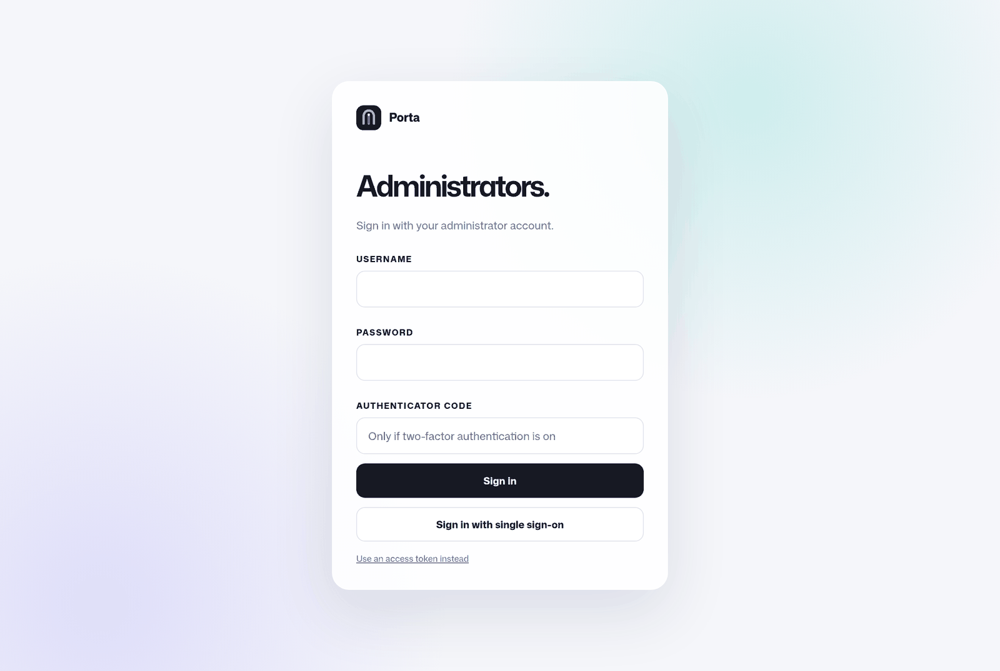
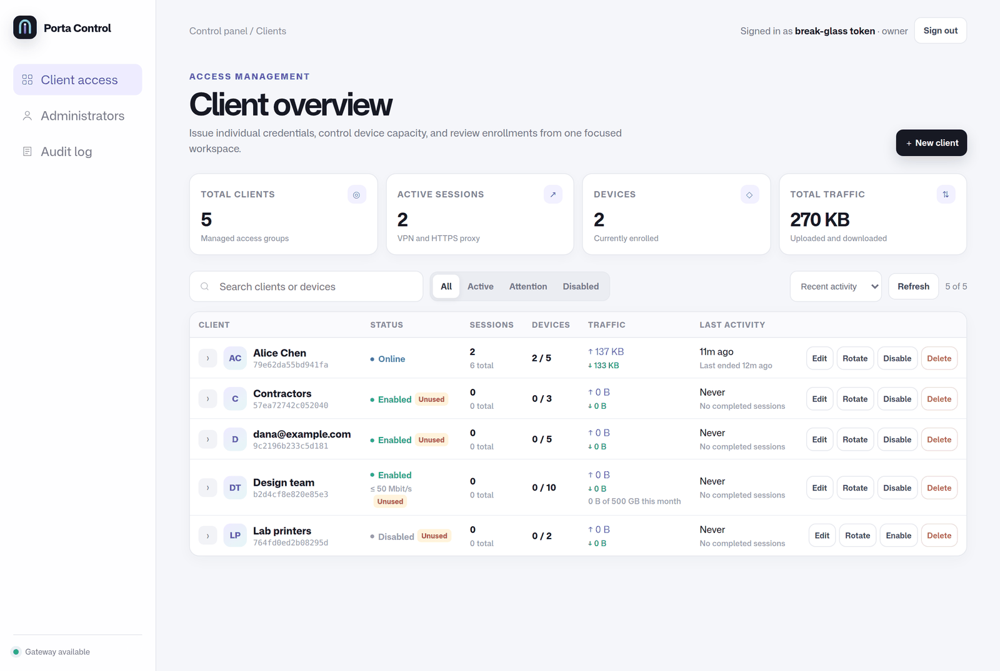
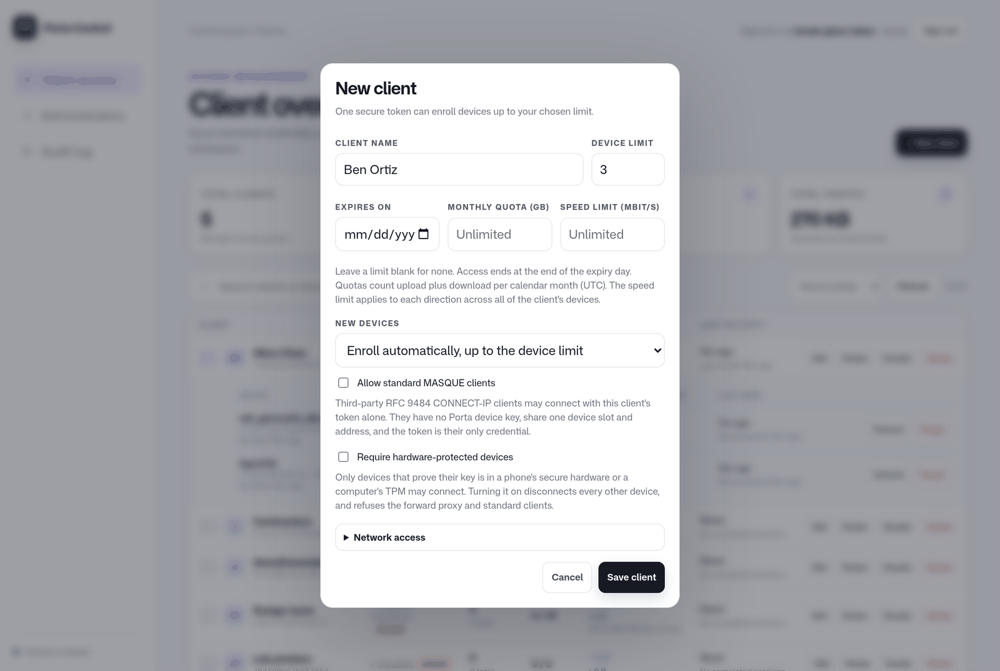
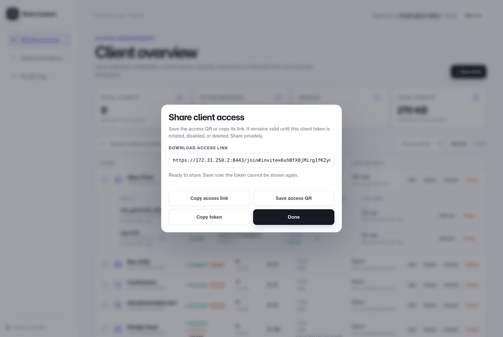
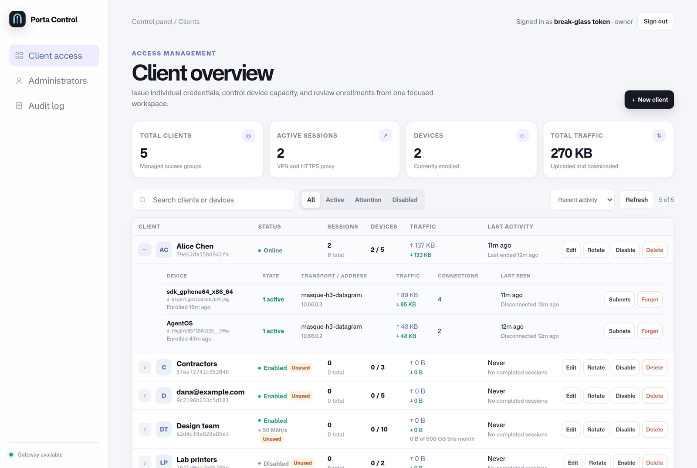
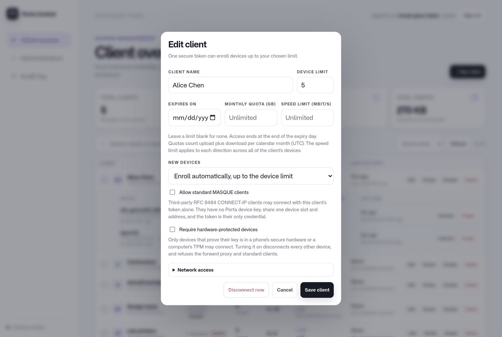
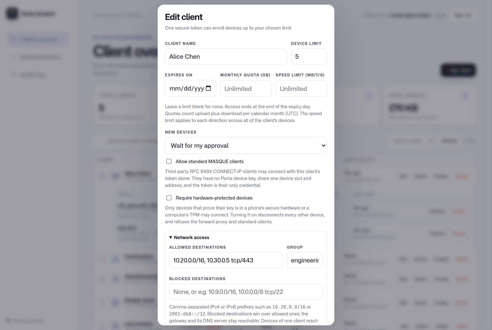
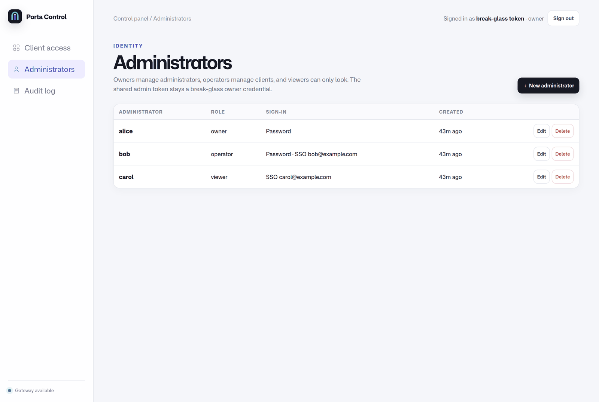
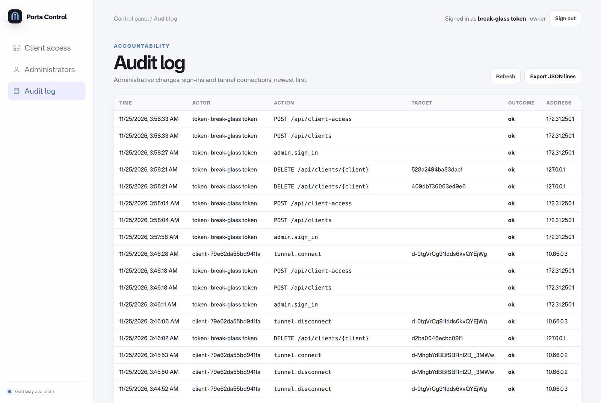

# Administrator guide

This guide walks through **Porta Control**, the gateway's web console, for
the people who manage accounts and devices. To install and run the gateway,
see [production deployment](deployment.md) and [operations](operations.md);
for what your users see, see the [user manual](user-manual.md).

- [Signing in](#signing-in)
- [The client overview](#the-client-overview)
- [Adding a person or team](#adding-a-person-or-team)
- [Devices](#devices)
- [Limits and policies](#limits-and-policies)
- [Rotating, disabling and deleting](#rotating-disabling-and-deleting)
- [Administrators](#administrators)
- [Audit log](#audit-log)

## Signing in

Open the gateway's address and go to `/admin/sign-in`. Sign in with your
administrator username and password, plus a code from your authenticator app
if you turned on two-factor authentication, or with **Sign in with single
sign-on** if the gateway is set up for it.



The gateway's `PORTA_ADMIN_TOKEN` is a break-glass owner credential: enter it
on the **Get access** page (**Use an access token instead**) to sign in when
no administrator account works, or to create the first ones. Retrieve it on
the server with:

```sh
sudo sed -n 's/^PORTA_ADMIN_TOKEN=//p' /etc/porta/porta.env
```

## The client overview

**Client access** lists every client account. A *client* is a person, a team
or a service. It has one access token that enrolls devices up to its device
limit.



- The cards at the top count clients, active sessions (VPN and HTTPS proxy),
  enrolled devices and total traffic.
- Search by client name, client ID, or a device's name or ID.
- **Attention** lists clients that may need a look: disabled or not active,
  devices awaiting approval, access ending within a week, a full device
  limit, never used (**Unused**), or no activity for 30 days (**Stale**).
- Each row shows the client's status and limits, its sessions, devices and
  traffic, and when it was last active.

## Adding a person or team

1. Choose **New client**.
2. Give it a **Client name**, such as the person's name, and a **Device
   limit**: how many devices may enroll with the token, from 1 to 100.
   Optionally set limits and policies, described [below](#limits-and-policies).
3. Choose **Save client**.



Porta then shows **Share client access**. Send the person the access link,
or the QR image from **Save access QR**, privately, for example in a direct
message rather than a group channel:



- The **access link** and **access QR** open the person's Downloads page
  without a token. They stay valid until you rotate the token, or disable or
  delete the client. They work only on this gateway's address, and stop
  working if the admin token changes.
- **Copy token** gives you the token itself, for setting up a desktop or
  command-line client by hand. It cannot be shown again after you close the
  dialog. If it's lost, use **Rotate** to issue a new one.

If the gateway lets users **sign in with their organisation** (see
[single sign-on for users](deployment.md#letting-users-sign-in-with-single-sign-on)),
people create their own account on first sign-in. It's named after their
email, and you manage it like any other client.

## Devices

Choose the arrow at the start of a client's row to see its devices.



Each device has a readable name (the computer's name or the phone's model),
a fixed ID derived from its key (`d-…`), its state, how it connects and its
tunnel address, its traffic and connection count, and when it was last
seen. A device that proved its key is in secure hardware shows **Hardware
key** with the TPM vendor or the Android security level.

- **Approve** or **Deny** a device that is **Awaiting approval**.
- **Forget** removes a device and disconnects it. It frees the device slot.
  If the device still has a valid token, it can enroll again; rotate the
  token as well to keep it out.
- **Subnets** lets a Linux device publish the network behind it to the
  tunnel. See [subnet routing](deployment.md#subnet-routing-site-to-site).

Deleting a profile in the app doesn't free a device slot. Forget the device
here when someone replaces or reinstalls a device.

## Limits and policies

Choose **Edit** on a client's row to change it.

<p>


</p>

| Setting | Effect |
| --- | --- |
| **Expires on** | Access ends at the end of that day. |
| **Monthly quota (GB)** | Upload plus download per calendar month (UTC). An account over its quota is disconnected until the next month. **Reset quota usage** starts the count again. |
| **Speed limit (Mbit/s)** | Applies in each direction, shared by all of the client's devices. |
| **New devices** | **Enroll automatically, up to the device limit**; **Wait for my approval**, where new devices wait until you approve them; or **Block new devices**. **Allow new devices for 15 min** lets new devices enroll directly for a while, whatever the policy. |
| **Allow standard MASQUE clients** | Lets third-party RFC 9484 CONNECT-IP clients connect with the token alone. Use it only for accounts dedicated to them. |
| **Require hardware-protected devices** | Only devices that prove their key is in secure hardware may connect. Turning it on disconnects every other device. See [hardware-protected devices](deployment.md#hardware-protected-devices). |
| **Network access** | **Allowed destinations** and **Blocked destinations** restrict what the client can reach, and a **Group** lets clients reach each other's devices. See [access policy](deployment.md#client-to-client-traffic-and-access-policy). Saving a change reconnects the client's devices. |

Leave a limit empty for none. Users see their limits in the apps and on
their Downloads page, with a clear message when access is refused.

**Disconnect now** ends the client's current sessions without changing
anything else. Apps that reconnect automatically may come straight back.

## Rotating, disabling and deleting

| Action | Effect |
| --- | --- |
| **Rotate** | Issues a new token and shows **Share client access** for it. Every device using the old token is disconnected, and old access links stop working. Send the person the new link; their app profiles need the new token. |
| **Disable** | Refuses the client and disconnects its devices until you choose **Enable**. Nothing else changes. |
| **Delete** | Removes the client, its token and its devices for good. |

Use **Rotate** if a token or access link has leaked.

## Administrators

Owners manage administrator accounts under **Administrators**. Give everyone
their own account rather than sharing the admin token.



- **Owner** manages administrators and everything else.
- **Operator** manages clients, devices, limits and access policies.
- **Viewer** can only look.

An administrator signs in with a password of at least 12 characters, a
**Single sign-on email**, or both. Each one can turn on two-factor
authentication from the page header. Disabling or deleting an administrator
takes effect immediately.

## Audit log

Owners and operators can open **Audit log**. It lists administrative changes, sign-ins and tunnel connections,
newest first, with who did it, the target, the outcome and the address.
**Export JSON lines** downloads the full log. On the server, the log is
`/var/lib/porta/audit.log`.


