# Porta user manual

Porta connects your computer or phone to your organisation's private network
through a secure tunnel, and protects your traffic on untrusted networks such
as hotel or café Wi-Fi. This manual is for the people who use Porta. If you
run the gateway, see the [administrator guide](admin-guide.md) and
[production deployment](deployment.md).

- [What you need](#what-you-need)
- [1. Get your access](#1-get-your-access)
- [2. Install and connect](#2-install-and-connect)
  - [Windows](#windows)
  - [Linux desktop app](#linux-desktop-app)
  - [Linux command line](#linux-command-line)
  - [Android](#android)
  - [macOS and iOS](#macos-and-ios)
- [3. Profile options](#3-profile-options)
- [4. Reading the connection screen](#4-reading-the-connection-screen)
- [5. Hotel, airport and café Wi-Fi](#5-hotel-airport-and-café-wi-fi)
- [6. Messages and what to do](#6-messages-and-what-to-do)
- [7. Troubleshooting](#7-troubleshooting)
- [8. Privacy and security](#8-privacy-and-security)

## What you need

Your administrator gives you one of these:

- an **access link** or **access QR code**;
- an **access token**, a long secret string, together with the gateway
  address such as `https://vpn.example.com`;
- permission to **sign in with your organisation's account**, such as your
  work email.

Treat all of these like a password. Anyone who has them can use your account.

## 1. Get your access

### With an access link or QR code

Open the link, or scan the QR code with your phone's ordinary camera app. It
opens your personal **Downloads** page directly, with no token to type.

### With an access token or your organisation's account

Open the gateway address in a browser. On the start page choose **Get
access**, then either paste your token and choose **Continue**, or choose
**Sign in with your organisation** and sign in as you normally do at work.

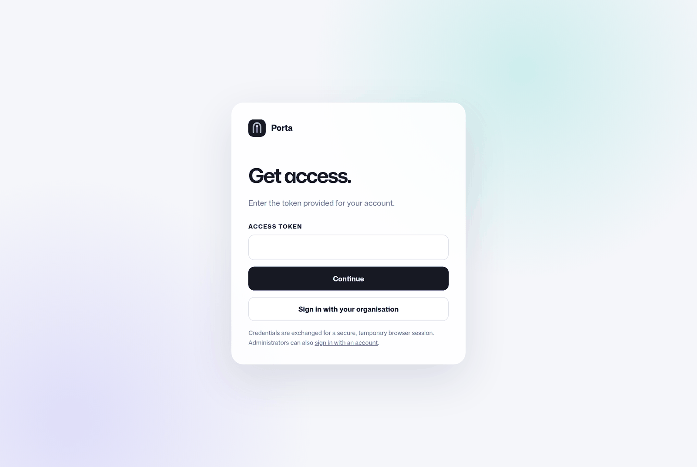

Signing in with your organisation creates your account the first time. When
you sign in again later, you get the same account, so devices you have
already set up keep working.

### The Downloads page

The Downloads page lists the Porta apps for every platform, with the
gateway's address, and shows your account's limits under **Your access** if
your administrator has set any. Its **Set up your profile** section holds
everything the app needs:

- a **profile QR code** for the Android app to scan;
- **Copy setup**, for setting up Android on the same phone;
- the **Server** address and your **Token**, under **Reveal token** and
  **Copy token**, for typing into the desktop apps.

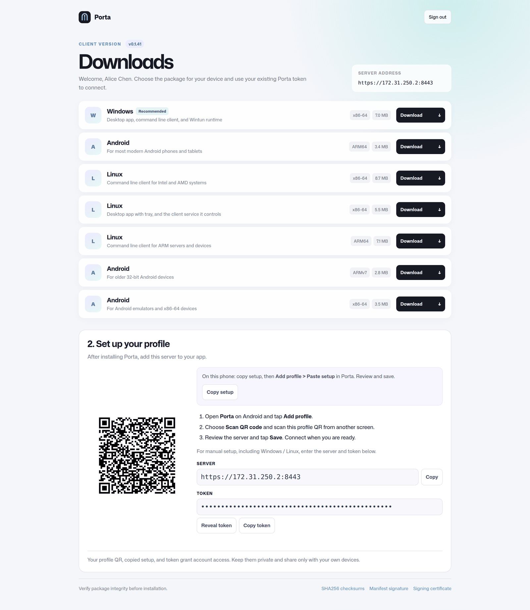

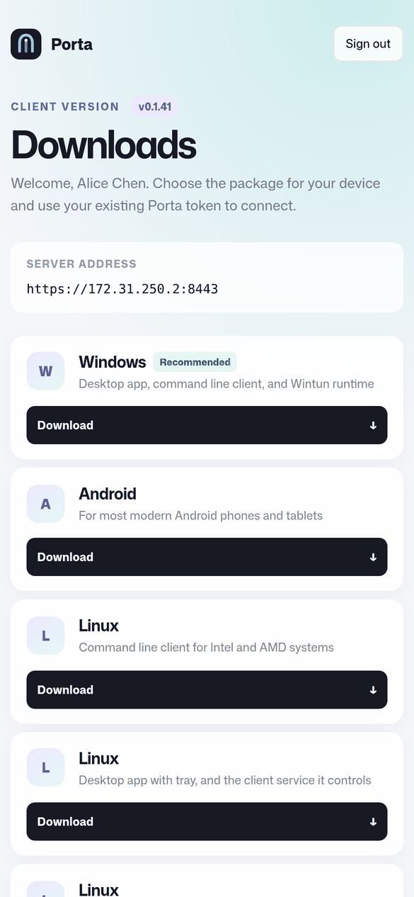

On a phone the page shows the same packages in a single column. Choose:

| Device | Package |
| --- | --- |
| Windows PC | **Windows**, `porta-client-windows-amd64.zip` |
| Most Android phones and tablets | **Android ARM64**, `porta-android-arm64-v8a.apk` |
| Older 32-bit Android devices | **Android ARMv7**, `porta-android-armeabi-v7a.apk` |
| Android emulators and x86-64 devices | **Android x86-64**, `porta-android-x86_64.apk` |
| Linux PC with a desktop | **Linux desktop app**, `porta-desktop-linux-amd64.tar.gz` |
| Linux server, or a terminal | **Linux command line client** for Intel/AMD or ARM |

The links at the bottom of the page let you check each package against its
published SHA-256 checksum before installing it.

<br clear="right">

## 2. Install and connect

### Windows

1. Extract `porta-client-windows-amd64.zip` to a folder you keep, such as
   `C:\Program Files\Porta`. If you later use **Connect automatically**, the
   app starts from this folder, so don't move it afterwards.
2. Start `porta.exe` and allow it to make changes to your device. Porta needs
   administrator rights to set up the tunnel. If Windows says the WebView2
   Runtime is missing, install Microsoft's Evergreen WebView2 Runtime; it is
   included with Windows 11 and current Windows 10.
3. Choose **Add profile**.

<p>
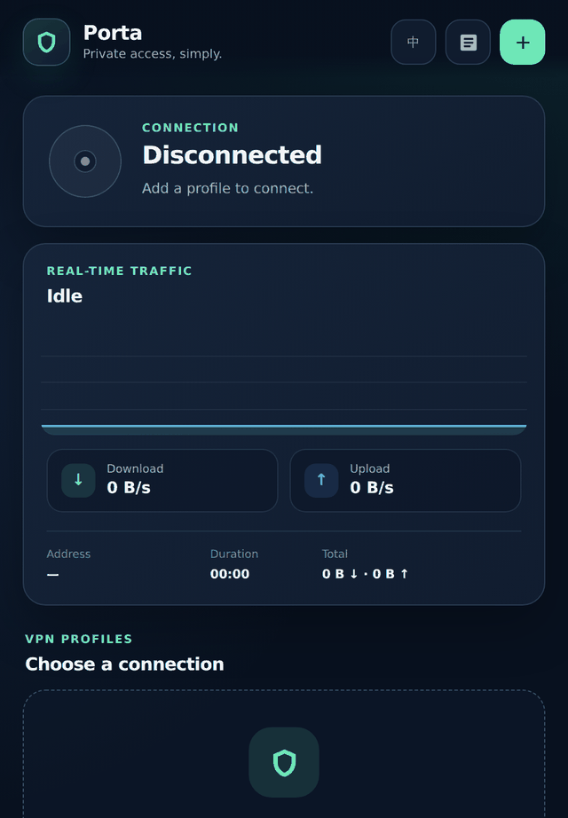
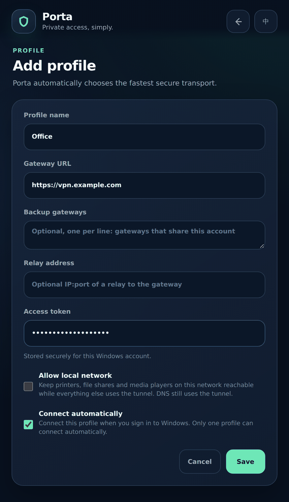
</p>

4. Enter a **Profile name** you will recognise, such as *Office*, the
   **Gateway URL** from your Downloads page, and your **Access token**. Leave
   the other fields empty unless your administrator asked you to fill them
   in (see [Profile options](#3-profile-options)). Choose **Save**.
5. Turn on the profile's switch to connect.

<p>
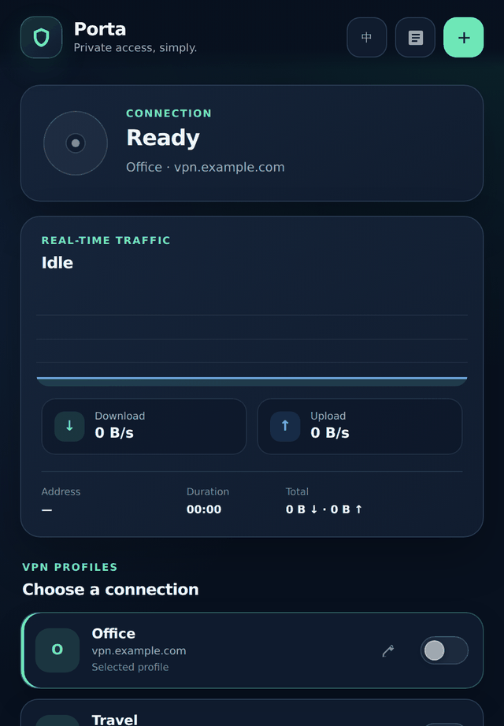
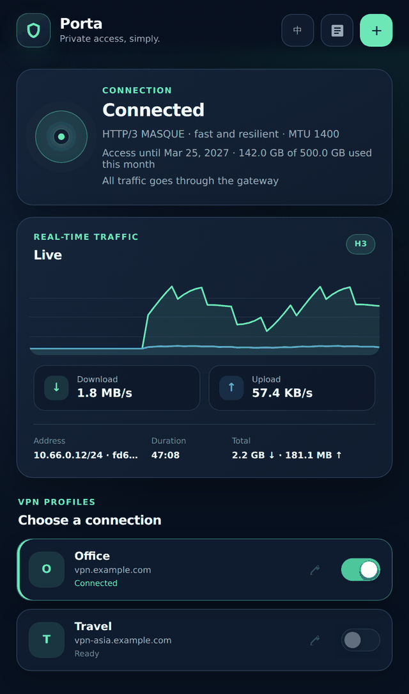
</p>

The switch is the only control you need: turn it off to disconnect. Porta
picks the fastest secure connection by itself, HTTP/3 where the network
allows it and HTTP/2 where it doesn't.

Good to know:

- **Closing the window keeps you connected.** Porta stays in the
  notification area by the clock. Its menu opens the window, connects or
  disconnects, shows the log, restores the network, or quits. **Quit**
  disconnects first.
- Choose the pencil next to a profile to edit it, or to delete it from the
  editor. Disconnect first; editing is unavailable while connected. When
  editing, leave **Access token** blank to keep the saved one.
- Porta stores your tokens protected for your Windows account.
- The **中** button in the header switches between English and Simplified
  Chinese. At first Porta follows your Windows language.

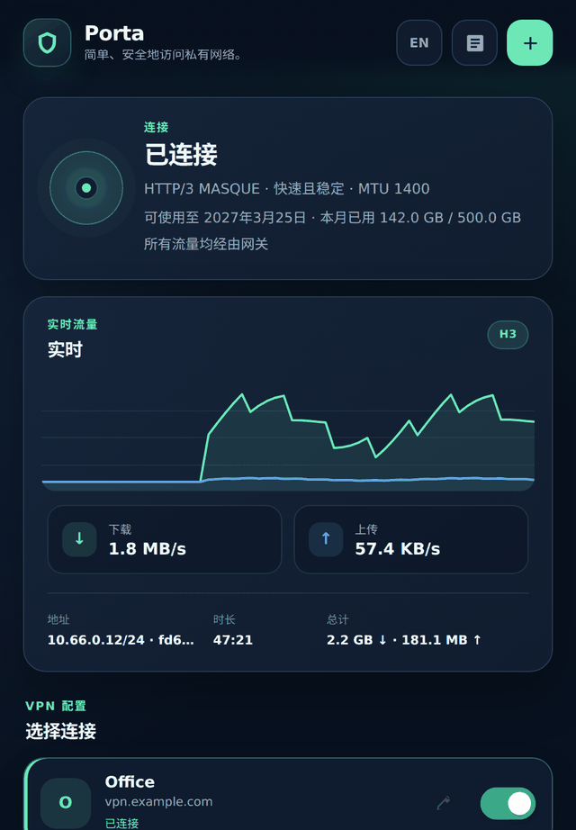

### Linux desktop app

The Linux desktop app looks and works like the Windows app. It runs on
Ubuntu 22.04 or later, Debian 12 or later, and other distributions with GTK 3
and WebKitGTK 4.1, on Intel and AMD (x86-64) computers.

```sh
sudo apt-get install -y libwebkit2gtk-4.1-0 libgtk-3-0
tar -xzf porta-desktop-linux-amd64.tar.gz
sudo ./porta-desktop/scripts/install-linux-desktop.sh
```

The installer adds **Porta** to your applications menu and adds you to the
`porta-client` group. **Sign out and back in once** before you start Porta,
so that the group applies. Then add a profile and connect as on Windows.

The connection is run by a background service, so closing or quitting the
window leaves you connected. Your profiles and tokens are kept by that
service in a file only the administrator (root) can read. The tray icon
needs a desktop with a status-notifier area; without one, closing the
window quits the app but the tunnel stays up.

### Linux command line

For servers and terminals, make the downloaded client executable and run it
with your token. Type or paste the token when asked:

```bash
chmod +x porta-client-linux-amd64
read -rsp "Client token: " PORTA_TOKEN && echo
export PORTA_TOKEN
sudo --preserve-env=PORTA_TOKEN ./porta-client-linux-amd64 \
  --server https://vpn.example.com
unset PORTA_TOKEN
```

The client stays in the foreground and prints `connected address=...` once
the tunnel is up. Press Ctrl+C to disconnect. It needs `iproute2`,
`nftables` and `systemd-resolved`. To run it as a service that starts at
boot, see the [client guide](clients.md#linux-cli).

### Android

**Install the app.** Open your access link on the phone, or scan the access
QR code with the camera, and download the Android package from the Downloads
page. Open the downloaded file and allow your browser to install apps when
Android asks. Porta needs Android 8.0 or newer.

**Add your profile.** Open Porta and tap **+** or **Add profile**. Choose
one of:

- **Scan QR code**: scan the *profile QR code* on your Downloads page,
  shown on another screen.
- **Paste setup**: on the same phone, tap **Copy setup** on the Downloads
  page first.
- **Enter manually**: type the profile name, the gateway address and your
  access token.

<p>
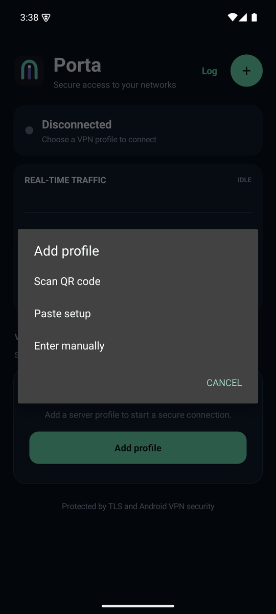
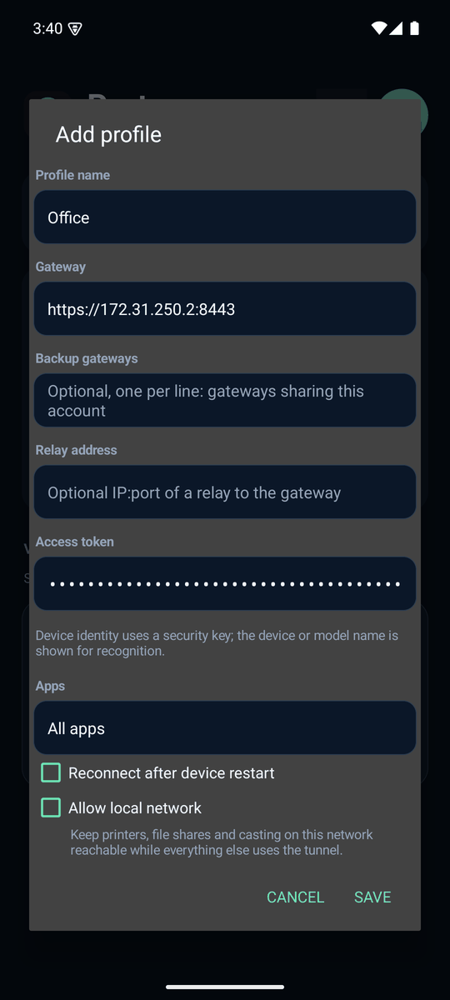
</p>

Check the gateway address and tap **Save**. Scanning or pasting creates a new
profile but never connects by itself.

**Connect.** Turn on the profile's switch. The first time, Android asks you
to allow Porta to set up a VPN connection; tap **OK**. While Porta is
connected, Android shows a key icon in the status bar.

<p>
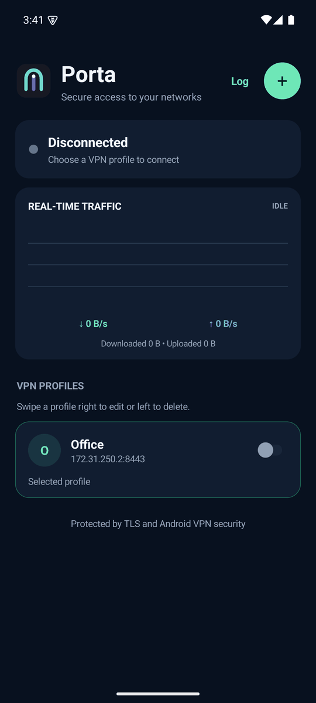
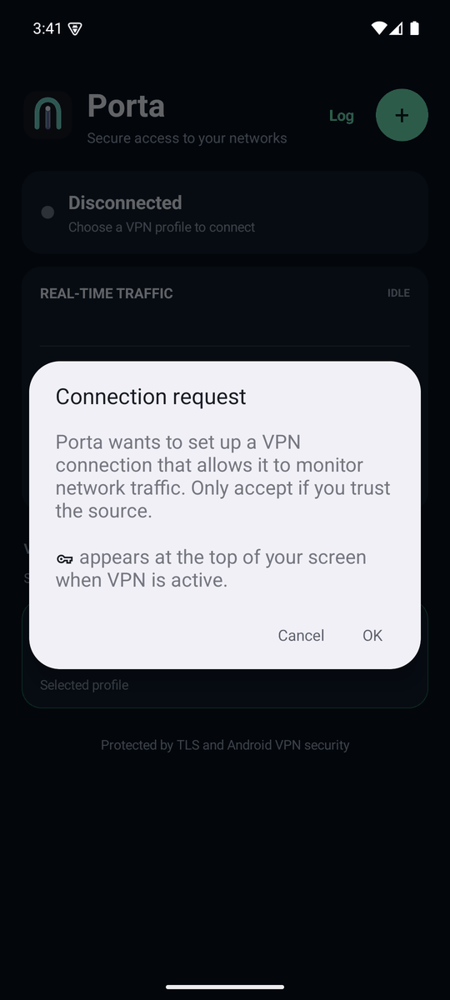
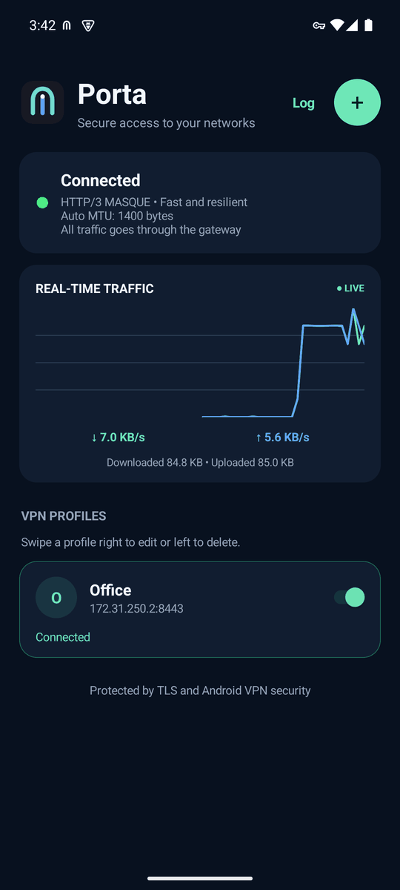
</p>

Good to know:

- **Swipe** a profile card at least halfway: **right to edit**, **left to
  delete**. Disconnect it first.
- **Log** shows what Porta has done, such as connection attempts, the
  transport used and the address you received. Use **Copy log** to send it
  to your administrator.
- Porta follows your phone's language. On Android 13 and newer you can choose
  English or Simplified Chinese for Porta alone in the system's app language
  settings.

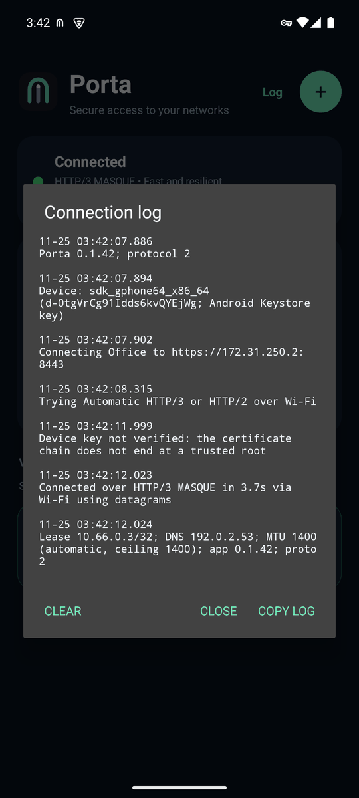

### macOS and iOS

There is no Porta app for Mac, iPhone or iPad yet.

## 3. Profile options

All of these are optional. Change them only if you need them or your
administrator tells you to.

| Option | Where | What it does |
| --- | --- | --- |
| **Backup gateways** | Windows, Linux, Android | Other gateways that share your account, one per line. Porta tries the fastest first and moves on if one is unavailable. |
| **Relay address** | Windows, Linux, Android | An `IP:port` your administrator gives you when the gateway is reached through a relay, for example on networks that block it. Porta then always connects through the relay. You cannot also use backup gateways. |
| **Allow local network** | Windows, Linux, Android | Keeps printers, file shares, casting and other devices on the network you're on reachable while everything else uses the tunnel. |
| **Connect automatically** | Windows, Linux | Connects this profile when you sign in to Windows, or when the Linux computer starts. Only one profile can have it. |
| **Reconnect after device restart** | Android | Connects this profile again after the phone restarts. |
| **Apps** | Android | Chooses which apps use the tunnel. See below. |

### Choosing which apps use the tunnel (Android)

By default every app uses the tunnel. Tap **Apps** in the profile dialog to
choose instead:

- **Only chosen apps use the tunnel**: for example only your browser and work
  email. Every other app uses your normal connection.
- **Chosen apps bypass the tunnel**: for example a banking app that refuses
  to work over a VPN.

<p>
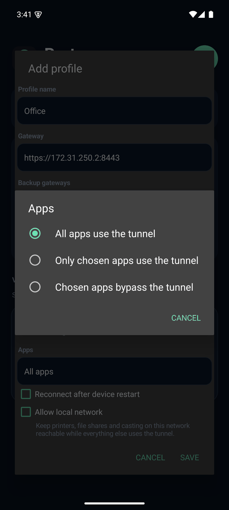
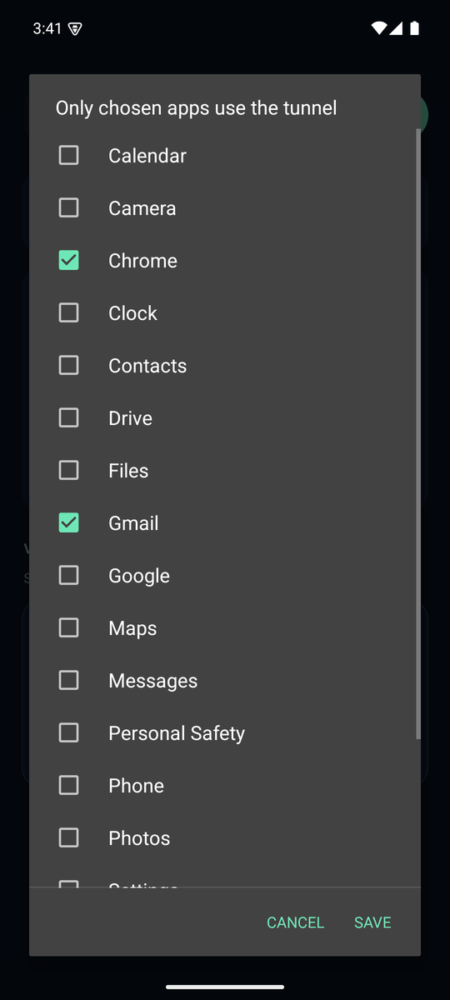
</p>

Apps kept outside the tunnel are not protected by it. If you use this
option, leave Android's **Block connections without VPN** setting off, since
it would also block those apps.

## 4. Reading the connection screen

The **Connection** card tells you where you stand:

- **Connected** with the transport, for example *HTTP/3 MASQUE · fast and
  resilient* or *4-lane HTTP/2 fallback*, and the tunnel's packet size (MTU).
- *All traffic goes through the gateway* for a full tunnel, or *Split tunnel
  · 2 networks via the gateway* when only your organisation's networks use the
  tunnel.
- Your **account limits**, if any: *Access until* a date, the data used this
  month, or a speed limit. The line is highlighted when access ends within a
  week or 90% of the monthly allowance is used.

**Real-time traffic** draws your download and upload speed, and the bottom
row shows your tunnel address, how long you've been connected, and the data
transferred. **Connecting** and **Reconnecting** mean Porta is setting up or
restoring the tunnel, for example after you changed Wi-Fi networks. Your
traffic stays blocked meanwhile rather than leaking outside the tunnel.

## 5. Hotel, airport and café Wi-Fi

Many public networks hold every connection until you accept their terms on a
sign-in page. While Porta is connecting it blocks everything outside the
tunnel, including that page. The desktop apps notice this and show **Network
sign-in required**:

<p>
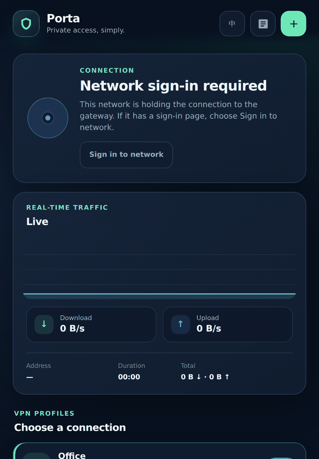
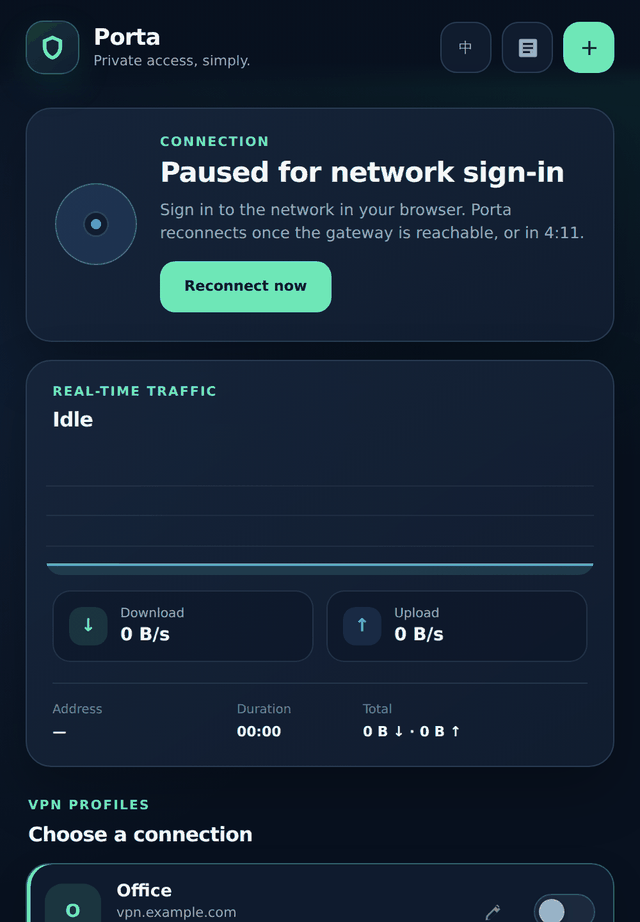
</p>

1. Choose **Sign in to network**. Porta lifts its protection for up to five
   minutes.
2. Open any web page in your browser. The network's sign-in page appears;
   sign in there.
3. Porta reconnects by itself as soon as it can reach the gateway, or when
   the five minutes are up. Choose **Reconnect now** if you're done sooner.

Your traffic is not protected by the tunnel during the pause, so don't use
anything sensitive until Porta shows **Connected** again.

- **Android** shows the network's sign-in notification itself; tap it and
  sign in. Porta connects once the network lets it through.
- **Linux command line**: press Ctrl+C to stop the client, sign in, then
  start it again.

## 6. Messages and what to do

| Message | What it means | What to do |
| --- | --- | --- |
| *This device is waiting for administrator approval.* | Your account needs an administrator to approve each new device. | Ask your administrator to approve it, then connect again. |
| *This account accepts no new devices.* | Your account is closed to new devices. | Ask your administrator to allow a new device. |
| An error saying the gateway returned *HTTP 401* | The token is wrong or was replaced, the account is disabled, or the account has reached its device limit. | Check the token in the profile. If you sign in with your organisation, sign in to the portal again and copy the current token from your Downloads page. Otherwise, ask your administrator. |
| *Your administrator has not allowed this device to connect.* | An administrator denied this device. | Contact your administrator. |
| *This account has expired.* | Your access had an end date that has passed. | Ask your administrator to renew it. |
| *This account has used its monthly data allowance.* | Your account has a monthly data limit. | Wait for the next month (counted in UTC), or ask your administrator to raise it. |
| *This version of Porta is too old for the gateway.* | The gateway requires a newer app. | Install the latest version from your Downloads page. |
| *This account accepts only devices whose key is protected by secure hardware…* | Your account requires a device with secure hardware, such as a TPM or the phone's security chip, and this device couldn't prove it has one. | Ask your administrator. Devices without such hardware can't use this account. |
| **Network sign-in required** | The Wi-Fi network is holding the connection. | See [hotel Wi-Fi](#5-hotel-airport-and-café-wi-fi). |
| **Network recovery available** | Porta kept its protection in place after an error. | Reconnect, or restore the network as described below. |

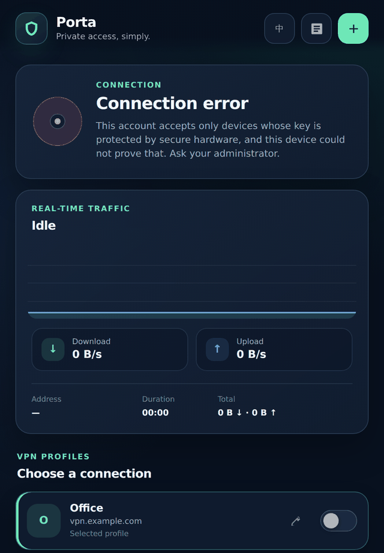

## 7. Troubleshooting

### I have no internet after an error

Porta never lets your traffic leak outside the tunnel, even after a crash or
an error. That's deliberate, but it means you can be left with no internet.
The status card shows **Network recovery available**:

- To get protection back, turn the profile's switch on again.
- To use the network without Porta, open the **Log** (the list icon in the
  header) and choose **Restore network**, or choose **Restore network** in the
  tray menu.

<p>
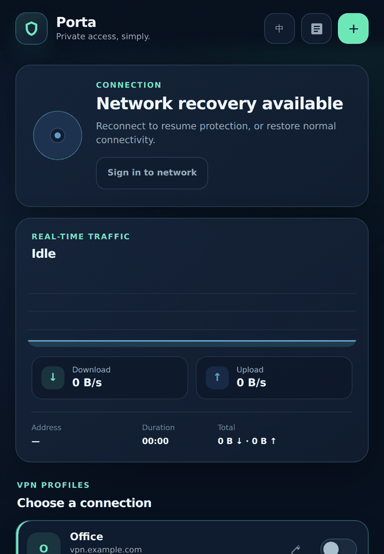
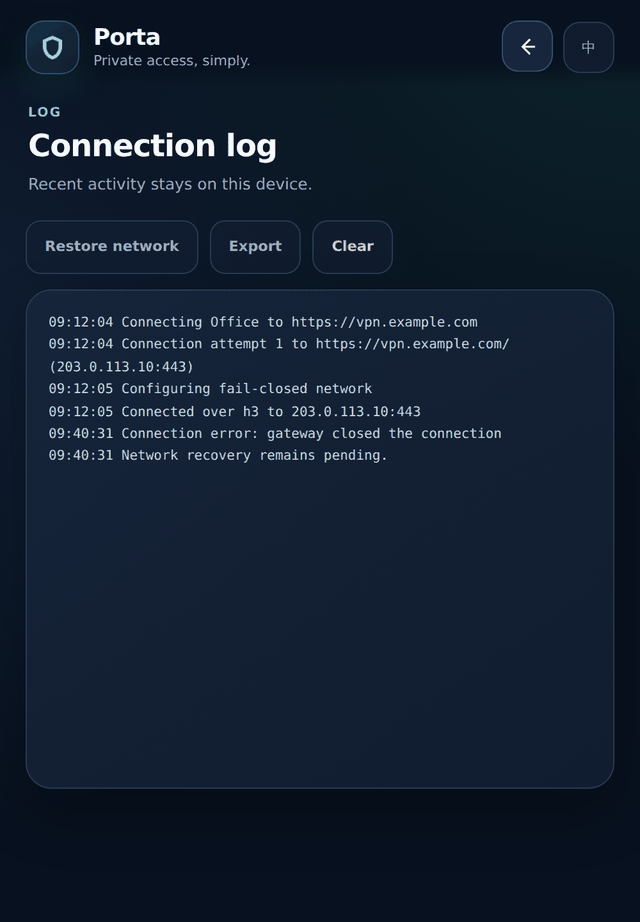
</p>

From a terminal, the same is done by:

- Linux command line: `sudo ./porta-client-linux-amd64 --cleanup-network`;
- Windows, in a terminal run as administrator: `porta-cli.exe
  --cleanup-network`.

On Android, turning the profile off restores the network.

### It connects, but slowly or not at all

- Check the log. **Log** in the header on Windows and Linux, **Log** at the
  top on Android. It shows each attempt and why it failed.
- Some networks block the UDP traffic that HTTP/3 uses. Porta then falls back
  to HTTP/2 by itself; the connection card shows which one is in use.
- Inside another VPN, Porta may not be able to use HTTP/3. Disconnect the
  other VPN, or ask your administrator.
- If your administrator gave you backup gateways or a relay address, add them
  to the profile.

### A printer, file share or TV no longer works

Turn on **Allow local network** in the profile, then reconnect.

### An app refuses to work over the VPN (Android)

Edit the profile, choose **Apps**, then **Chosen apps bypass the tunnel**,
and select the app.

### "Certificate" or "untrusted" errors

Check that the gateway address is exactly the one on your Downloads page.
Don't connect if you can't explain the error: it can mean the network is
intercepting your connection.

### Sending a log to your administrator

On Windows and Linux, open the **Log** and choose **Export**. On Windows the
file is saved under `%APPDATA%\Porta\exports`. On Android, open **Log** and
choose **Copy log**. Logs never contain your token, but they do contain
addresses and your device name, so send them only to your administrator.

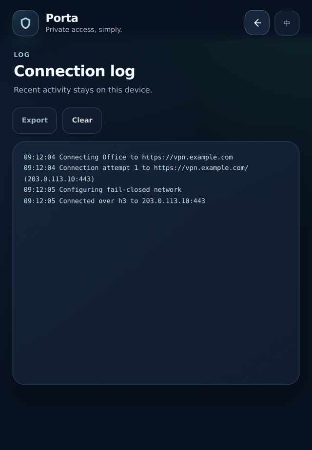

## 8. Privacy and security

- **Your device has its own key.** On first use, Porta creates a key on your
  device. Where the device has secure hardware, the key is kept in it: the
  TPM on Windows, or Android's protected keystore. The key never leaves the
  device. Your administrator sees your devices by their names, such as your
  computer's name or phone model.
- **Reinstalling makes a new device.** Uninstalling the Android app, clearing
  its data or deleting Porta's identity file on a computer creates a new key,
  which counts as a new device on your account. Deleting a profile doesn't
  remove the device from your account; ask your administrator to forget
  devices you no longer use.
- **What your administrator can see:** your devices' names, when they
  connected and from which address, how much data they used, and the tunnel
  address each one received. Porta does not log the websites you visit. Your
  traffic does pass through the gateway, though, as with any VPN.
- **Keep your token, QR codes and copied setup private.** Anyone who has them
  can use your account, up to its device limit. If you think one has leaked,
  tell your administrator; rotating the token locks it out.
